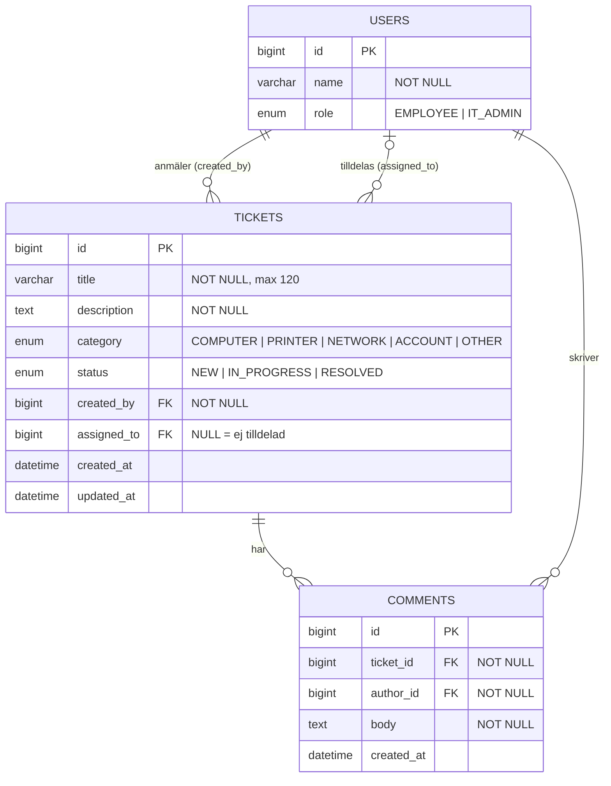

# Databasschema

Utkast, version 1 (2026-10-19). Utgår från Must-storyna i backloggen. Ska bli klart i pass 3.

## Diagram

Samma schema som Mermaid. GitHub ritar upp det, och det är lätt att ändra:

## Tabeller

| Tabell | Innehåll |
|---|---|
| `users` | En person som använder appen, med rollen anställd (`EMPLOYEE`) eller IT-ansvarig (`IT_ADMIN`). Fylls med testdata från start, eftersom MVP:n inte har inloggning. |
| `tickets` | Ett ärende. Har alltid en anmälare (`created_by`) och kan vara tilldelat en IT-ansvarig (`assigned_to`) eller ingen. |
| `comments` | En kommentar i ett ärende, skriven av en anställd eller en IT-ansvarig. |

Tabellen heter `users` och inte `user`, eftersom `user` är ett nyckelord i flera databaser.

## Vilka stories behöver vad?

| Story | Tabeller och fält |
|---|---|
| Välja vem man är | `users` (name, role). Att valet finns kvar efter omladdning sparas i webbläsaren, inte i databasen. |
| Anmäla ett fel | `tickets` (title max 120 tecken, description, category, status = `NEW`, created_by, created_at) |
| Se mina ärenden / Se alla ärenden / Filtrera på status | `tickets`, plus `users` för anmälarens och den tilldelades namn |
| Öppna ett ärende | `tickets`, `users` |
| Ändra status | `tickets.status`, `tickets.updated_at` |
| Tilldela ett ärende | `tickets.assigned_to` |
| Kommentera / Svara på kommentarer | `comments` |

## Designval

- **Kategori och status är enum och lagras som text** (`@Enumerated(EnumType.STRING)` i JPA). Värdena är få och ändras inte av användarna. Lagras som text så att databasen går att läsa och så att det går att byta till en egen tabell senare. Se beslut 5 i beslutsloggen.
- **`tickets` har två kopplingar till `users`:** anmälare (`created_by`) och tilldelad (`assigned_to`). I JPA blir det två `@ManyToOne` med var sin `@JoinColumn`. Att `assigned_to` är tomt betyder "Ej tilldelad".
- **Bara IT-ansvariga får tilldelas.** Det kan inte databasen kontrollera, så det görs i service-lagret.
- **Inget fält för e-post eller lösenord än.** De läggs till med storyna om inloggning och mejl, så att schemat inte innehåller sådant som ingen story behöver.
- **Förslag:** kommentarer tas bort tillsammans med sitt ärende (cascade). Ingen story tar bort ärenden, men det är bestämt om det behövs.

## Planerade utökningar

Ingen story i backloggen kräver att strukturen ändras. Alla senare stories lägger bara till kolumner eller tabeller.

| Story | Vad den kräver | Typ av ändring |
|---|---|---|
| Ange hur bråttom det är (Should) | Kolumnen `urgency` i `tickets`, standardvärde Normal | Lägger till |
| Logga in med lösenord (Should) | `email` och `password_hash` i `users` | Lägger till |
| Mejl när ärendet är löst (Could) | `email` i `users` (samma som ovan) | Lägger till |
| Bifoga skärmdump (Could) | Ny tabell `attachments` kopplad till `tickets` | Lägger till |
| Statistik per kategori (Could) | Inget nytt. Räknas fram ur befintlig data. | Ingen |
| Skapa ärende via mejl (Won't) | Inget i databasen | Ingen |

## Öppna frågor till pass 3

**Hur skapas och ändras tabellerna i databasen?** Vi kör alla mot MariaDB på Davids VPS (beslut 6 och 7). Det finns två vanliga sätt:

- **Hibernate skapar tabellerna själv** (`spring.jpa.hibernate.ddl-auto=update`). Inget extra att göra. Men så fort någon startar backend ändras den gemensamma databasen efter just den personens kod, även från en branch som inte är mergad. Hibernate lägger till kolumner men tar aldrig bort eller byter namn på dem.
- **Migreringsfiler med Flyway.** Varje ändring av databasen är en numrerad SQL-fil i repot, t.ex. `V1__skapa_tabeller.sql` och `V2__testdata.sql`. Filerna granskas i pull requests som all annan kod, och alla får exakt samma databas. Hibernate kontrollerar bara att koden stämmer med databasen (`ddl-auto=validate`).

Om vi väljer Flyway behöver vi också bestämma om var och en ska ha en egen databas att utveckla mot, eller om nya migreringar bara får köras från `develop`.

**Testdata:** de fyra anställda och två IT-ansvariga som "Välja vem man är" behöver. Läggs de in med en migrering eller på annat sätt?
