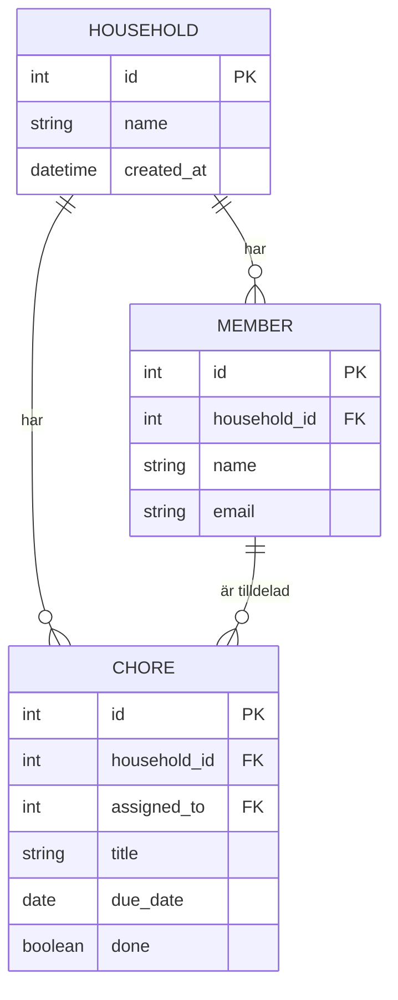

# Databasschema

<!--
  INSTRUKTION
  Utgå från era Must-stories: vilka tabeller och fält behövs för att bygga dem?
  Ni kan antingen
    a) rita schemat i ett verktyg (dbdiagram.io, drawSQL, Excalidraw) och lägga in bilden här, eller
    b) skriva det som ett Mermaid-diagram direkt i den här filen. GitHub ritar upp det automatiskt.
  Uppdatera schemat när det ändras. Större ändringar skrivs också in i beslutsloggen.
-->

## Diagram

<!-- Alternativ a: lägg bilden i docs/bilder/ och länka den så här: -->
<!--  -->

<!-- Alternativ b: Mermaid. Exemplet nedan är Sysslo. Ersätt det med ert eget schema. -->

## Tabeller

<!-- Kort förklaring av varje tabell: vad den innehåller och varför den finns. -->

> **Exempel:**
>
> | Tabell | Innehåll |
> |---|---|
> | `household` | Ett hushåll, t.ex. "Korridor 4B". |
> | `member` | En person i ett hushåll. |
> | `chore` | En syssla. Kan vara tilldelad en medlem eller ingen. |

| Tabell | Innehåll |
|---|---|
| | |
